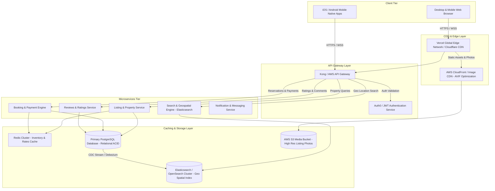

# Production Architecture Diagram & Scaling Strategy

## High-Level Vacation-Rental Marketplace Architecture

---

## Architecture Components & Scaling Strategy

### 1. Frontend & Edge Distribution
- **Tech Stack**: React 19 / Vite hosted on **Vercel Edge Network**.
- **Caching & Asset Delivery**: Images served in modern `.avif` / `.webp` formats via **AWS CloudFront** with dynamic image resizing and browser cache headers (`Cache-Control: public, max-age=31536000, immutable`).
- **Client Performance**: Lazy-loading image galleries, code splitting routes, and instant skeleton states.

### 2. Microservices Core
- **Listing & Property Service**: Manages property details, amenities, host data, and room categories.
- **Search & Geospatial Engine**: Leverages **Elasticsearch / OpenSearch** with Geo-Point indexing to allow instant bounding-box map searches and price filtering.
- **Booking & Inventory Engine**: Uses **Redis distributed locks** (Redlock algorithm) to prevent double-booking of listing dates during peak checkout concurrency.
- **Database Architecture**: PostgreSQL for primary ACID transactional data (bookings, user profiles, payouts).

### 3. High Availability & Disaster Recovery
- **Multi-Region Deployment**: Active-Active database replica in primary AWS regions.
- **Cache Invalidation**: Event-driven cache update via Kafka/RabbitMQ whenever host updates listing availability or rates.
